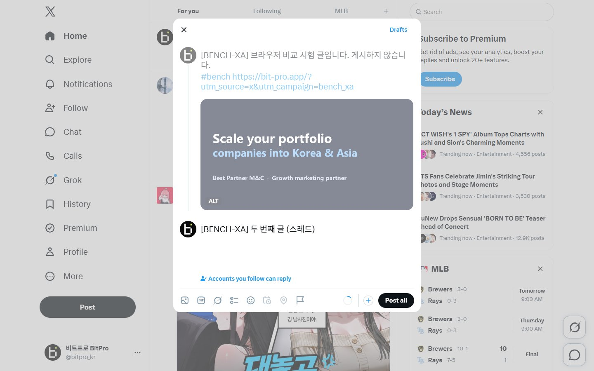
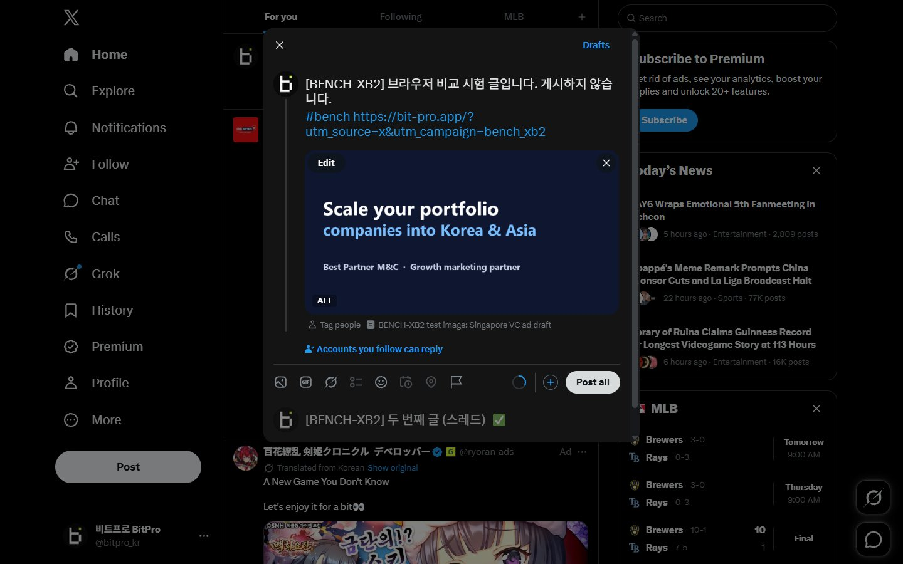
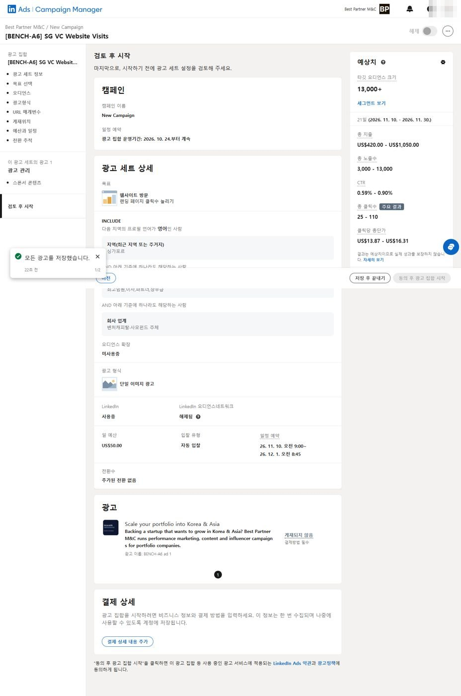
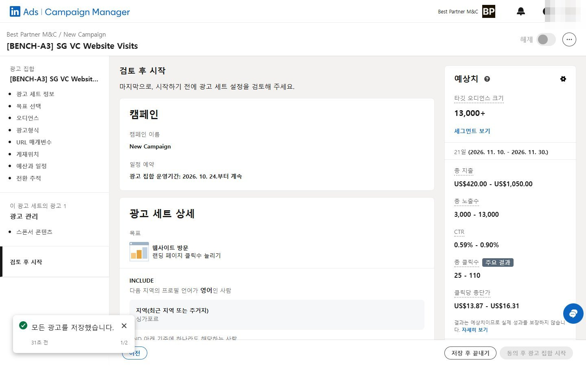
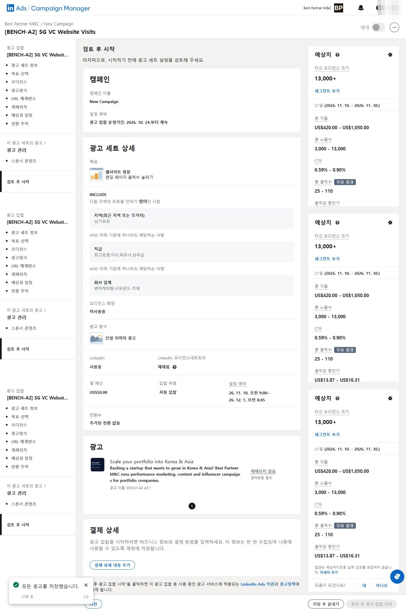
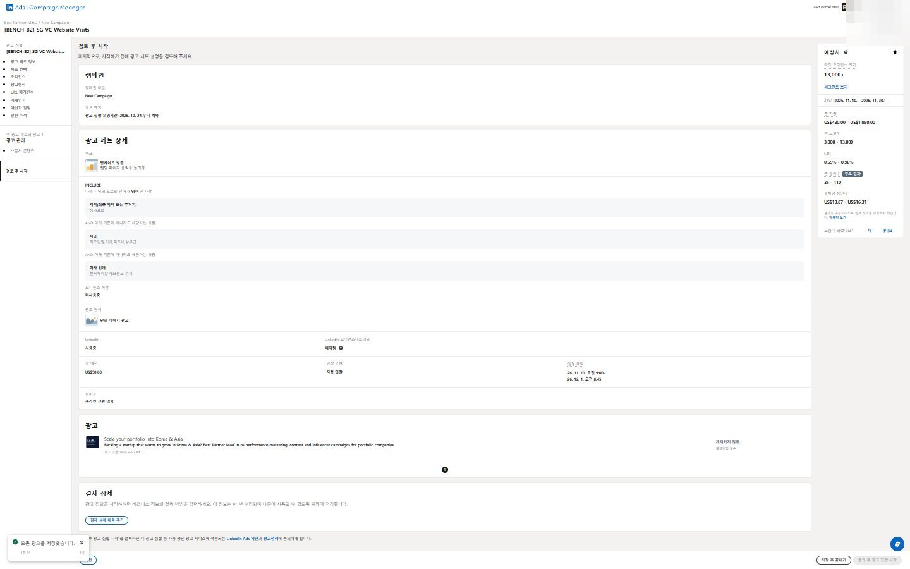
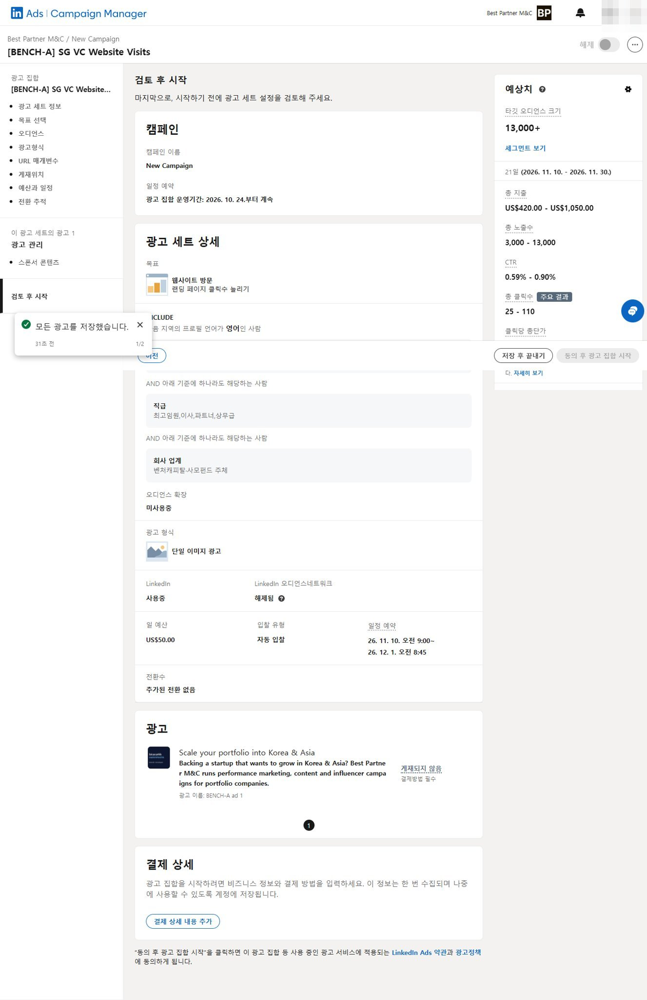
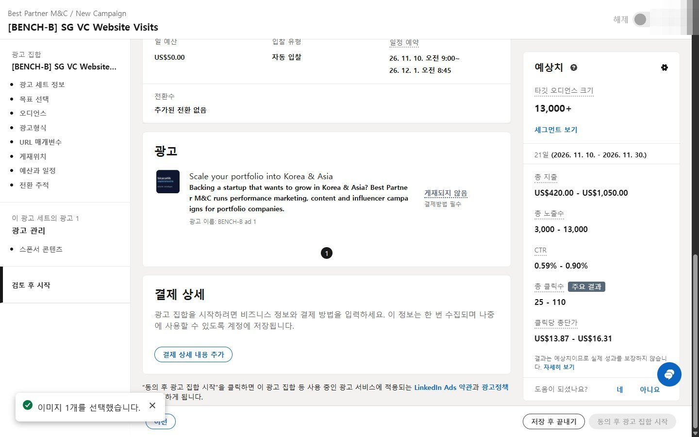
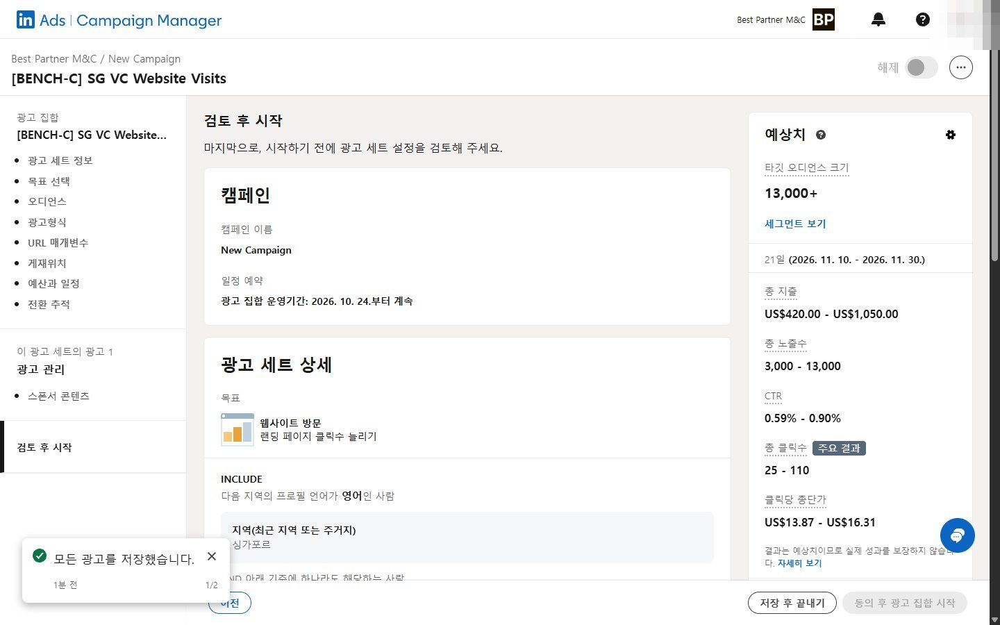

# 브라우저 비교 시험 — 링크드인 광고 세팅·X 게시물 작성 (2026-10-27)

> 회차를 거듭하며 No.VI 브라우저를 고친 기록이다. 최신 회차(8회차)가 맨 위에 있다. 시나리오는 [`../scenarios/`](../scenarios/)에 있다. "카드"는 No.VI에서 일을 맡아 도는 에이전트 세션이다.

## 8회차 — 카드가 No.VI 브라우저 에이전트에 통째로 맡김 (2026-10-27)

카드가 X 시나리오를 `novi_browser.py agent No17 --site X "<지시>"` 한 번으로 넘겼다. 에이전트는 명령 실행 도구 하나만 가진 가벼운 claude -p(Opus 5.5)이고, 창 없이(헤드리스) 카드 탭에서 돌았다.

| 회차 | 시간 | 비용 | 걸음 | 정확도 | 비고 |
|---|---|---|---|---|---|
| XA4 | 2분 47초 | $0.56 | 24 | 7/7 | 사이트 요령 읽기가 5초 제한에 걸려 못 읽음, 열린 메뉴에 가려진 버튼에서 10초 막힘 |
| XA5 | **2분 02초** | **$0.46** | 19 | 7/7 | 요령 읽기 제한 10초로, 가려진 버튼은 3초 만에 이유와 함께 알림 |
| 참고: XA (카드가 직접) | 1분 55초 | $0.70 | 18 | 7/7 | |
| 참고: XB2 (Aside 에이전트) | 1분 54초 | $0.36 | 18 | 7/7 | |

- 비용은 카드가 직접 할 때보다 34% 줄었고 Aside와 $0.10 차이다. 시간은 Aside보다 8초 길다.
- 숨은 버튼은 1.5초, 가려지거나 꺼진 버튼은 3초 만에 이유를 알려 준다(전에는 10초씩 기다림).
- 두 회차 모두 작성 창을 감독이 확인한 뒤 버렸다. 게시·임시저장 없음.

## 7회차 — X 게시물을 게시 직전까지 (2026-10-27)

비트프로 X(@bitpro_kr)에서 두 방식이 같은 일을 했다: 작성 창 열기 → 두 줄 글(해시태그·링크) → 이미지 붙이기 → 이미지 설명(ALT) → 스레드로 두 번째 글(이모지 포함) → 답글 설정 "내가 팔로우하는 계정" → 작성 창 캡처, 게시는 누르지 않음. 끝난 뒤 감독이 작성 창을 직접 읽어 대조하고 "삭제"로 지웠다(게시·임시저장 없음).

| 항목 | XA No.VI 브라우저 | XA3 No.VI 브라우저 (가벼운 에이전트) | XB2 Aside 에이전트 |
|---|---|---|---|
| 소요 시간 | 1분 55초 | 2분 12초 | 1분 54초 |
| 도구 호출 | 18 | 18 | 18 |
| 브라우저 시간 / 생각 시간 | 42초 / 70초 | 54초 / 73초 | 41초 / 73초 |
| 정가 환산 비용 | $0.70 | **$0.41** | $0.36 |
| 매 걸음 다시 읽는 바탕 지시 | 약 4만 3천 토큰 | **약 9천 토큰** | 약 2만 1천 토큰 |
| 정확도 (감독 대조) | 7/7 | 7/7 | 7/7 |
| 게시 버튼 | 안 누름 | 안 누름 | 안 누름 |

XA3는 같은 모델·같은 지시에 에이전트만 가볍게(명령 실행 도구 하나, 연결 도구·스킬 목록 없이) 돌렸다. 비용이 $0.70 → $0.41로 줄어 Aside와 비슷해졌다. 시간이 17초 늘어난 것은 숨은 버튼을 누르다 10초 기다린 것과 작성 창만 찍다 10초 기다린 것 두 번 때문이다(우연한 차이).

- **시간·호출·브라우저 시간은 사실상 같다.** 링크드인 6회차에 이어 엔진 차이는 더 보이지 않는다.
- **비용 차이는 브라우저가 아니라 에이전트 바탕 지시의 크기다.** 쓴 글(출력)은 둘 다 약 5,400토큰으로 같은데, No.VI 쪽은 매 걸음 다시 읽는 바탕 지시가 Aside의 약 두 배(누적 106만 대 51만 토큰)였다.
- 둘 다 X의 투명한 덮개 층 때문에 ALT 저장·스레드 추가 버튼의 보통 클릭이 안 먹어 직접 누르는 방식으로 넘어갔다.
- 첫 Aside 시도(XB)는 이 프로필이 '다른 폴더 읽기 막힘' 설정이라 이미지를 못 붙였다(3분 42초, 5/7). 권한을 링크드인 때(u0)와 같게 풀고 다시 한 것이 XB2다.
- No.VI 브라우저에 X 계정 프로필(No17)을 새로 만들고 로그인 요령 한 줄을 남겼다.

---

## 6회차 — 엔진 차이 두 개를 고친 뒤 (2026-10-27)

Aside 실행 기록(B2)을 단계별로 No.VI(A5)와 맞대 봤다. **두 쪽 다 같은 모델이고, 한 단계 생각하는 시간도 3.9초로 같았다.** 같은 기억(Aside의 B회차 기록)도 둘 다 읽었다. 차이는 브라우저 쪽 시간(A5 234초, Aside 156초)에서 났다. Aside도 고정 대기를 105초나 넣었으니 대기 자체는 차이가 아니었다.

엔진에서 찾은 차이:
1. **사라진 버튼 번호를 10초씩 기다림.** 화면이 다시 그려지면 버튼에 새 번호가 붙고 옛 번호는 다시 안 돌아오는데, No.VI는 옛 번호를 누르면 10초를 다 기다린 뒤 실패했다(A5에서 다섯 번, 약 50초). → 바로 "이 번호는 없다, 새 번호는 이것"이라고 알려 주게 고침.
2. **우리 안내가 엉뚱한 기다리기를 시킴.** "특정 화면은 wait_for_selector로 기다린다"는 안내 때문에 링크드인의 안 보이는 '업로드중' 글자를 60초, 숨은 목록을 10초씩 두 번 기다렸다. Aside 에이전트는 이런 기다리기를 안 하고 화면을 다시 읽는다. → 안내를 "다시 읽어 본다"로 바꿈.

| 항목 | A5 No.VI (전) | **A6 No.VI (고친 뒤)** | B2 Aside |
|---|---|---|---|
| 소요 시간 | 8분 14초 | **5분 48초** | 6분 22초 |
| 도구 호출 | 66 | **54** | 57 |
| 정가 환산 비용 | $2.49 | **$1.95** | $2.00 |
| 브라우저 시간 / 생각 시간 | 234초 / 258초 | **115초 / 231초** | 156초 / 225초 |
| 화면 그림 확인 | 6번 | **4번** | 7번 |
| 좌표로 누르기 | 2번 | **0번** | 0번 |
| 정확도 (저장값 대조) | 17/17 | **17/17** | 17/17 |
| 집행 버튼 | 안 누름 | 안 누름 | 안 누름 |

**결론: 같은 일에서 No.VI 브라우저가 Aside보다 34초 빠르고 비용도 조금 적다.** 6회차는 엔진 수정과 5회차 뒤 남긴 링크드인 요령 두 줄을 함께 썼다.

남은 초안: BENCH-A6 추가. 결제수단이 없어 집행되지 않는다.

---

## 4·5회차 — 고정 대기를 없앤 뒤 (2026-10-27)

"쉬는 시간"은 사람처럼 보이려는 장치가 아니었다. 에이전트가 누를 때마다 1~3초씩 직접 넣은 대기(3회차 52번, 152초)였다. 사람처럼 천천히 움직이는 것은 네이버 같은 사이트의 **로그인할 때만** 쓰고, 그대로 둔다.

Aside처럼 바꾼 것:
- 4회차 전: 카드가 넣은 고정 대기(몇 초 쉬기, 네트워크가 조용해질 때까지 기다리기)는 **화면이 멈추는 순간 끝난다.** 정해진 시간보다 길게 기다리지 않는다.
- 5회차 전: 이름 없는 버튼은 그 안의 글자로 보이고, 지금 열린 창(팝업)만 골라 읽을 때 숨겨진 창이 아니라 보이는 창을 읽는다.
- 5회차 뒤: 두 번 되풀이된 실수를 링크드인 요령으로 남겼다(이미지 업로드 완료를 '업로드중' 글자로 기다리지 않기, '확인' 팝업의 저장·취소는 번호로 누르기).

| 항목 | A3 No.VI (전) | **A4 No.VI** | **A5 No.VI** | B2 Aside |
|---|---|---|---|---|
| 소요 시간 | 8분 07초 | **7분 46초** | **8분 14초** | 6분 22초 |
| 도구 호출 | 65 | 69 | 66 | 56 |
| 정가 환산 비용 | $2.61 | $2.83 | **$2.49** | $2.00 |
| 고정 대기 | 52번 · 152초 | **1번 · 2초** | **5번 · 9초(모두 바로 끝남)** | - |
| 화면 그림 확인 | 10번 | 8번 | **6번** | 7번 |
| 브라우저 시간 / 생각 시간 | 262초 / - | 236초 / 228초 | 234초 / 258초 | - |
| 정확도 (저장값 대조) | 17/17 | 17/17 | 17/17 | 17/17 |
| 집행 버튼 | 안 누름 | 안 누름 | 안 누름 | 안 누름 |

**결론: 고정 대기 152초는 0에 가깝게 없어졌다. 그래도 Aside보다 약 1분 30초~1분 50초 느리다.**

- 남은 차이 ① 이미지 업로드가 끝났는지 '업로드중' 글자로 기다리다 **두 번 다 60초를 헛기다림**(그 글자는 화면에 안 보이는 안내로 늘 남아 있다). → 링크드인 요령으로 남겼다.
- 남은 차이 ② '다음'·'광고 저장' 뒤 오른쪽 아래 '확인' 팝업을 그림으로 보고 좌표로 누름. 다시 확인해 보니 그 팝업의 저장·취소 버튼은 누른 결과 목록에 나오는데, 뒤 화면 전체가 함께 바뀌어 목록이 길어져 놓친 것. → 요령으로 남겼다.
- 남은 차이 ③ 생각 시간: 브라우저는 약 4분, 모델이 다음 할 일을 생각하는 시간이 약 4분이다. Aside 에이전트는 사이트 기억을 더 오래 쌓아 이 시간이 짧다.
- 비용 차이: 회차마다 ±10% 흔들린다. 5회차가 No.VI 중 가장 쌌다.

남은 초안: BENCH-A4, BENCH-A5 추가. 모두 결제수단이 없어 집행되지 않는다.

---

## 3회차 — No.VI 브라우저에 Aside식 화면 읽기를 붙인 뒤 (2026-10-27 19:05~19:14)

Aside 프로그램은 자기 브라우저에 묶인 닫힌 프로그램이라 통째로 옮길 수 없다. 대신 Aside가 빠른 이유인 **읽는 방식**을 No.VI 브라우저에 붙였다. 같은 방식이 No.VI 브라우저가 쓰는 브라우저 엔진에 공식 기능으로 들어 있다.

- 화면을 그림 대신 **누를 것마다 번호(e12)가 붙은 글자 목록**으로 읽는다(누를 것만, 창 하나만 골라 읽기 가능).
- 그 번호로 누르고 넣으면 **바뀐 줄만** 돌려준다.
- 없는 것을 누를 때 기다리는 시간 30초 → 10초.

| 항목 | A2 No.VI (기억만) | **A3 No.VI (기억 + 새 읽기)** | B2 Aside |
|---|---|---|---|
| 소요 시간 | 9분 58초 | **8분 07초** | 6분 22초 |
| 도구 호출 | 89 | **65** | 56 |
| 출력 토큰 | 21,156 | 19,441 | 16,732 |
| 캐시 읽기 토큰 | 6.70M | 6.13M | 3.97M |
| 정가 환산 비용 | $2.88 | **$2.61** | $2.00 |
| 화면 그림 확인 | 32번 | **7번** | 7번 |
| 30초 멈춤 | 4번 | **0번**(10초 실패 3번) | - |
| 정확도 (저장값 대조) | 17/17 | **17/17** | 17/17 |
| 집행 버튼 | 안 누름 | 안 누름 | 안 누름 |

**결론: 그림 확인과 긴 멈춤은 Aside 수준으로 줄었고, 시간 19%·비용 9% 줄었다. Aside와의 차이는 아직 1분 45초 남았다.**

- 남은 차이의 가장 큰 원인: 도구 시간 262초 중 **152초가 에이전트가 직접 넣은 고정 대기**(누른 뒤 1~3초 쉬기 52번)다. 새 누르기 기능은 이미 화면이 멈출 때까지 기다리므로 필요 없는 대기다. → 카드 안내에 "누른 뒤 고정 대기를 붙이지 않는다"를 더했다(다음 측정 전).
- 정확도: 이름·목표·싱가포르·영어·업종·직급 4개·확장 끔·네트워크 끔·단일 이미지·US$50·11/10~11/30·광고 이름·소개 글·헤드라인·UTM 주소·이미지(sg_vc_ad.png) 모두 저장값과 같다.
- A3가 겪은 것: 광고 편집기가 지난 시험(B2)의 문구·이미지를 미리 채워 둬서 지우고 다시 넣음. 예산 칸에 기존 값 뒤로 붙어 25,050달러가 됐다가 바로 50달러로 고침. 오디언스 네트워크 스위치와 이미지 '선택' 버튼은 화면 좌표로 누름.

남은 초안: BENCH-A3 추가. 결제수단이 없어 집행되지 않는다.

---

## 2회차 — 같은 기억으로 다시 (2026-10-27 18:30~18:46)

No.VI 브라우저에 Aside 기억(374개)을 옮긴 뒤 A·B를 같은 지시로 다시 돌렸다. 이번엔 겹치지 않게 하나씩 차례로 돌렸다.

| 항목 | A No.VI 1회차 | **A2 No.VI (기억 있음)** | B Aside 1회차 | **B2 Aside** |
|---|---|---|---|---|
| 소요 시간 | 9분 01초 | 9분 58초 | 6분 23초 | **6분 22초** |
| 도구 호출 | 60 | 89 | 57 | 56 |
| 출력 토큰 | 17,003 | 21,156 | 14,981 | 16,732 |
| 캐시 읽기 토큰 | 5.07M | 6.70M | 4.08M | 3.97M |
| 정가 환산 비용 | $2.23 | $2.88 | $2.04 | **$2.00** |
| 정확도 (저장값 대조) | 17/17 | **17/17** | 17/17 | **17/17** |
| 집행 버튼 | 안 누름 | 안 누름 | 안 누름 | 안 누름 |

**결론: 기억을 맞춰도 No.VI 브라우저가 빨라지지 않았다. 차이는 기억이 아니라 조작 방식에서 난다.**

- A2는 첫 실행에서 링크드인 요령을 받았고, 지난 작업 기록(BENCH-B)도 두 번 찾아 읽었다. 기억은 제대로 쓰였다.
- 그런데도 느렸던 이유:
  - **화면을 그림으로 확인한 횟수가 32번**이다(1회차 6번). 한 번 볼 때마다 대화가 길어져 토큰이 늘었다.
  - **누르기가 30초씩 멈춘 것이 4번**(약 2분)이다. 버튼 이름으로 누르면 링크드인 화면에서 기본 대기 30초를 다 쓰고 실패해서, 화면 위치로 다시 눌렀다.
  - (정정) Aside 에이전트도 매 단계 조작 코드를 쓴다. 차이는 화면을 읽는 방식이다: 번호 붙은 글자 목록과 바뀐 줄만 보기 → 3회차에서 No.VI에 붙임.
- Aside는 1·2회차가 거의 같다(6분 23초 → 6분 22초). No.VI 브라우저는 회차마다 편차가 크다(9분 → 10분, 도구 호출 60 → 89).
- 두 초안 모두 저장값이 지시와 같다: 이름·목표·싱가포르·영어·업종·직급 4개·확장 끔·네트워크 끔·단일 이미지·US$50·11/10~11/30·광고 이름·소개 글·헤드라인·UTM 주소·이미지.

남은 초안: BENCH-A2, BENCH-B2 추가. 결제수단이 없어 집행되지 않는다.

---

# 1회차

## 결론 (1회차)

- **세 방식 모두 정확도 100%** (확인 가능한 17개 항목 모두 지시대로, 집행 0건, 기존 초안 손대지 않음).
- **빠르고 싼 순서: Aside 에이전트 > No.VI 브라우저 > Claude가 Aside를 직접 조작.**
- Aside 에이전트는 지난 10/25 이 계정을 만든 기억이 있어 계정 찾기 단계를 건너뛰었다(유리한 조건). 이 차이를 빼면 Aside와 No.VI 브라우저의 격차는 작다.

## 시나리오

- 광고 계정: Best Partner M&C (결제수단 없음 → 집행 자체가 불가능한 상태)
- 광고 세트 `[BENCH-X] SG VC Website Visits`: 목표 웹사이트 방문 / 싱가포르 / 프로필 언어 영어 / 업종 벤처캐피탈·사모펀드 주체 / 직급 파트너·최고임원·상무급·이사 / 오디언스 확장 끔 / 오디언스 네트워크 끔 / 단일 이미지 / 일 예산 US$50 / 2026-11-10~11-30
- 광고 1개: 이름·소개 글·헤드라인·이미지 업로드·UTM 주소·버튼(자세히 보기)
- 검토 화면에서 멈춤 (집행 버튼 금지)

## 방식

| 코드 | 방식 | 조작 주체 | 브라우저 |
|---|---|---|---|
| A | No.VI 브라우저 | Claude Opus 5.5 (Claude Code) → `novi_browser.py exec` (Playwright) | No10 (LinkedIn 계정) |
| B | Aside 에이전트 | Aside 에이전트 (설정: claude-code / Opus 5.5, thinking high) | Aside u0 (같은 계정) |
| C | Claude + Aside repl | Claude Opus 5.5 (Claude Code) → `aside repl` 직접 조작 | Aside u0 |

세 방식 모두 같은 모델(Claude Opus 5.5), 같은 지시문, 질문 없이 끝까지 혼자 수행.

## 결과

| 항목 | A No.VI 브라우저 | B Aside 에이전트 | C Claude+Aside repl |
|---|---|---|---|
| 소요 시간 | 9분 01초 | **6분 23초** | 13분 58초 |
| 도구 호출(턴) | 60 | 57 | 86 |
| 출력 토큰 | 17,003 | **14,981** | 30,213 |
| 캐시 읽기 토큰 | 5.07M | **4.08M** | 7.66M |
| 캐시 쓰기 토큰 | 110k | 116k | 125k |
| 정가 환산 비용 | $2.23 | **$2.04** | $3.14 |
| 정확도 (독립 검증 17항목) | 17/17 | 17/17 | 17/17 |
| 집행 버튼 | 안 누름 | 안 누름 | 안 누름 |
| 검토 화면 캡처 | 전체 1장 + 단계별 9장 | 3장 + 이어붙인 1장 | 3장 |

- 비용은 API 정가로 환산한 값(실제로는 구독 한도에서 차감).
- 정확도는 에이전트 보고가 아니라 광고 관리자에 저장된 실제 값을 따로 읽어 대조했다: 이름·목표·위치·언어·업종·직급 4개·확장·네트워크·형식·예산·통화·시작일·종료일·광고 이름·소개 글·헤드라인·URL·이미지 업로드. 버튼 문구(자세히 보기)는 저장값을 읽을 길이 없어 세 방식의 보고로만 확인.

## 방식별로 막힌 점

- **A No.VI 브라우저**: 큰 막힘 없음. 처음 광고주 화면이 계속 떠서 우회. 단계마다 캡처를 남겨 추적이 가장 쉬움.
- **B Aside 에이전트**: 이미지가 작업 폴더에서 바로 안 올라가 임시 폴더로 복사 후 업로드. 지난 세션 기억(계정 ID, 화면 요령)을 써서 빠름.
- **C Claude+Aside repl**: 호출마다 탭이 닫혀 상주 세션을 직접 짜서 우회, 날짜 칸 지우기·화면 캡처 시간 초과 등 시행착오가 가장 많음. 같은 Aside라도 사람이 하나하나 누르는 방식은 1.5~2배 비싸다.

## 공통 발견

- 계정 추적 설정 때문에 모든 광고 URL 뒤에 `utm_id`·`utm_medium=paid-social`이 자동으로 붙고 `utm_source`가 두 번 들어간다.
- 타깃 규모 13,000+ (링크드인 권장 50,000+보다 작음).
- 기본 캠페인 "New Campaign"(10/24부터 계속)에 세 초안이 들어감.

## 한계

- 방식마다 1회씩만 돌림. A와 B는 시간이 겹쳐 동시에 돌았다.
- B는 이 계정 기억이 있어 유리했다. 처음 보는 계정이면 차이가 줄 수 있다.
- Claude in Chrome은 Owner 전역 규칙(사용 금지)으로 제외.

## 남은 것

- 초안 3개(BENCH-A·B·C)는 광고 계정에 그대로 있다. 결제수단이 없어 집행되지 않는다.

