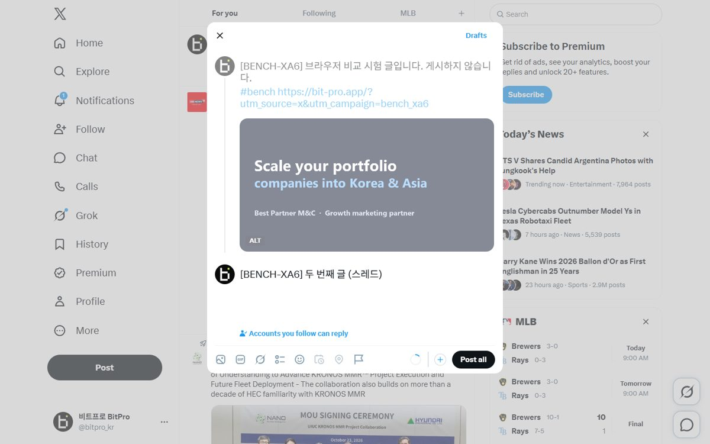
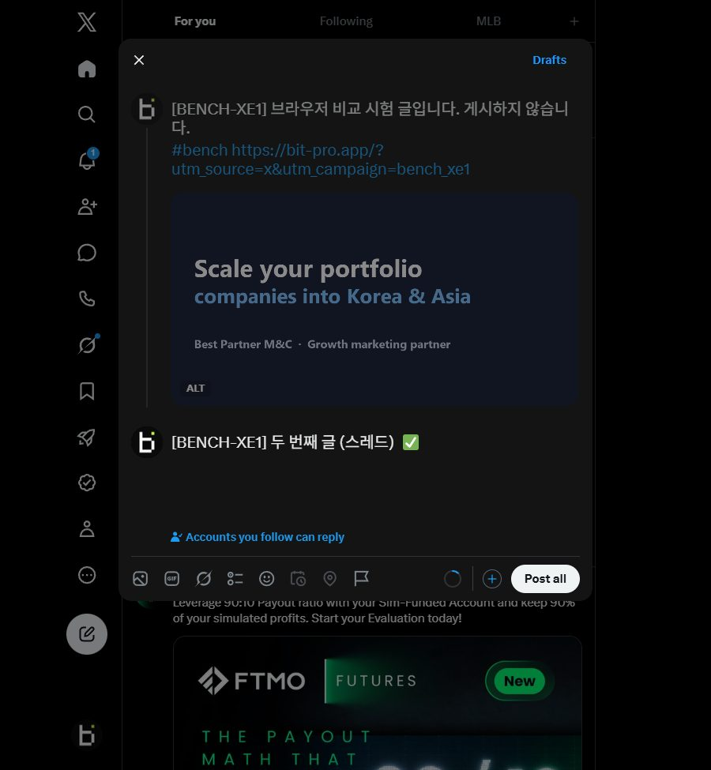
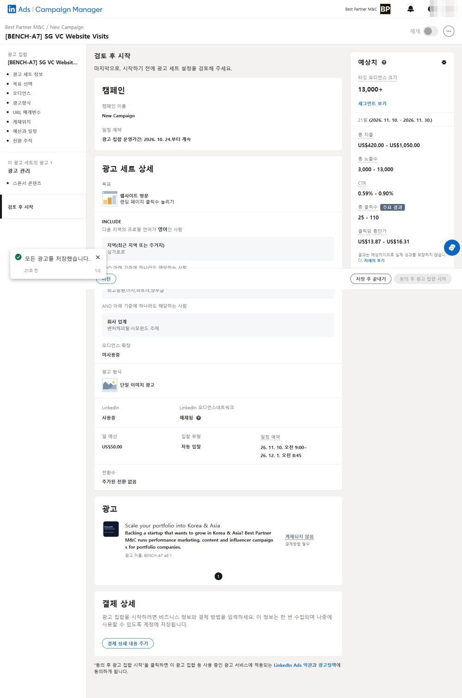
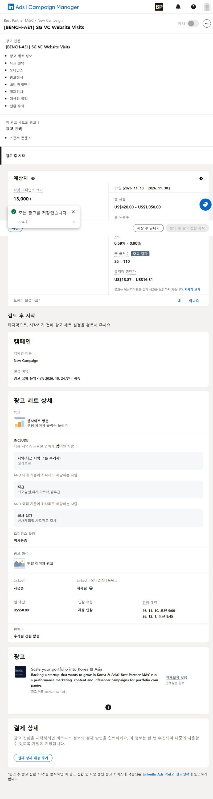

# 브라우저 비교 시험 — No.VI · Ego Lite · Aside (2026-10-28)

## 세 브라우저 한눈에

| 기준 | No.VI 브라우저 | Ego Lite | Aside | 나은 쪽 |
|---|---|---|---|---|
| 정확도 (X 7 + 링크드인 17) | 24/24 | 24/24 | 24/24 | 같음 |
| X 게시 직전까지 | **1분 15초 · $0.34** | 1분 54초 · $0.47 | 1분 54초 · $0.36 | No.VI |
| 링크드인 광고 초안 | **6분 13초 · $1.56** | 7분 11초 · $1.81 | 6분 22초 · $2.00 | No.VI |
| 두 일 합계 | **7분 28초 · $1.90** | 9분 05초 · $2.28 | 8분 16초 · $2.36 | No.VI |
| 창 없이 돌리기 | **기본이 창 없음.** 로그인·인증 때만 창을 띄움 | 창이 떠 있어야 함. 창 없이 띄우면 명령을 거부 | 에이전트는 화면에 뜬 Aside 창에서만 돎(명령에 창 없이 쓰는 옵션 없음) | **No.VI** |
| 다른 계정 나누기 (로그인 따로) | **됨.** 계정마다 프로필 하나(지금 18개), 계정마다 따로 켜지고 꺼짐 | 제한적. 프로필은 있으나 빈 프로필을 새로 못 만들고 다른 브라우저에서 가져오기만 됨(이번 1개). 스페이스는 로그인을 같이 써서 계정은 못 나눔 | **됨.** 프로필 10칸, 계정마다 로그인·쿠키 따로. 다만 모든 프로필이 한 프로그램 안에서 돌아 하나가 멈추면 전부 다시 켜야 함 | No.VI·Aside |
| 같은 계정 안 세션 나누기 | **됨.** 카드마다 자기 탭·변수 | **됨.** 스페이스마다 탭 묶음 | **됨.** 일(세션)마다 탭 묶음. 이어 하기·방향 바꾸기 됨. 사용자가 쓰는 창을 같이 씀 | 비슷함 |
| 세션 끝낼 때 | 그 카드 탭만 닫힘 | 마지막 페이지에서 끝내면 브라우저 전체가 꺼진다는 보고 | 그 일의 탭만 닫힘 | No.VI·Aside |
| 메모리: 페이지 1개 | 694MB | **540MB** | 830MB (브라우저 501 + 에이전트 상주 프로그램 329) | Ego |
| 메모리: 세션 3개 | 1,386MB | **1,202MB** | 1,283MB (브라우저 954 + 상주 프로그램 329) | Ego (셋 차이 15% 안) |
| 메모리: 쉴 때 | **5분 쉬면 스스로 꺼져 0MB** | 창을 닫아도 뒤에서 430MB | 늘 켜 둠. 지금 사용자 창·카드 탭 포함 11.3GB + 상주 프로그램 329MB | **No.VI** |
| 사이트 요령·기억 | 사이트마다 저장, 다음 회차가 읽음 | 없음 | 사이트 기억·사이트별 스킬이 가장 많이 쌓여 있음 | Aside |
| 같은 게시 두 번 누르기 막기 | 기록하고 막음 | 확인된 기능 없음 | 확인된 기능 없음 | No.VI |
| 설치·준비 | 이미 설치 | 설치 + 10단계 첫 실행 안내 | 이미 설치(사용자가 늘 쓰는 브라우저) | No.VI·Aside |

- **종합: No.VI가 시간·비용·창 없이 돌리기·쉴 때 메모리에서 앞선다.** 나누기는 셋 다 되지만, 다른 계정을 나누는 건 No.VI·Aside만 제대로 되고 Ego는 스페이스가 로그인을 같이 써서 계정 분리가 안 된다. 돌아가는 동안 메모리는 Ego Lite가 가장 가볍고, 사이트 기억은 Aside가 가장 많다.
- Aside의 시간·비용은 하루 전(10-27) 시험의 같은 시나리오 값이다(링크드인 6회차, X 8회차). 그날 같은 시각에 돌린 No.VI는 링크드인 5분 48초·$1.95, X 2분 02초·$0.46이었다. 다른 날이라 사이트 상태는 조금 다를 수 있다.
- Aside 메모리 재는 법: 사용자가 쓰는 Aside는 프로필 10개와 사용자 탭이 한 프로그램에 같이 돌아 따로 잴 수 없다. 그래서 로그인 없는 빈 Aside를 임시 폴더로 따로 띄워(사용자 프로필과 떨어진 창) 같은 페이지 3개(위키백과 "Web browser", BBC News, GitHub Explore)를 창을 띄운 채 열고 15초 뒤 쟀고, 잰 뒤 지웠다. 에이전트가 쓰는 상주 프로그램(329MB)은 지금 도는 것을 쟀다. No.VI도 조종 프로그램(약 160MB)을 넣은 값이라 같은 기준이다.
- Aside 창 없이 돌리기: 브라우저 엔진은 창 없이 띄워도 페이지가 열렸다(세션 3개 965MB). 하지만 Aside 에이전트·명령은 화면에 떠 있는 Aside 앱에 붙어 그 프로필 창에 탭을 여는 방식이라, 창 없는 엔진을 쓸 방법이 없다.

## No.VI vs Ego Lite 결론

- **두 브라우저 모두 정확도는 만점**이다. X 7/7, 링크드인 17/17 (감독이 저장된 값을 직접 읽어 대조).
- **No.VI 브라우저가 더 빠르고 싸다.** 두 시나리오를 합치면 No.VI는 7분 28초·$1.90, Ego Lite는 9분 05초·$2.28로, No.VI가 시간 18%·비용 17% 적게 들었다.
- 차이의 큰 몫은 **사이트 요령**이다. No.VI 에이전트는 지난 시험에서 쌓인 X·링크드인 요령을 읽고 바로 들어갔고, Ego Lite는 처음 보는 화면을 매번 살펴야 했다. Ego Lite는 시작할 때 사용 안내(약 2만 3천 자)도 한 번 읽는다.
- **창 없이 돌리기·계정 나누기·쉴 때 메모리는 No.VI가 낫다.** Ego Lite는 이 PC에서 창 없이 띄우면 명령을 받지 않았고, 새 빈 프로필을 만드는 방법이 없어 계정마다 나누기 어렵다. 쉬는 동안 No.VI는 스스로 꺼져 메모리를 0으로 돌려주지만, Ego Lite는 창을 닫아도 뒤에서 430MB를 계속 쓴다.
- **돌아가는 동안의 메모리는 Ego Lite가 가볍다.** 같은 페이지 3개를 열었을 때 No.VI 1,386MB, Ego Lite 1,202MB로 No.VI가 약 15% 더 썼다. No.VI는 브라우저를 조종하는 프로그램 두 개가 약 160MB를 더 쓴다.
- 같은 계정 안에서 일을 나누는 단위는 둘이 비슷하다(No.VI는 카드마다 탭, Ego Lite는 작업 공간마다 탭 묶음. 둘 다 같은 로그인을 같이 쓴다).
- Ego Lite는 실행할 때마다 이 컴퓨터의 모든 AI 에이전트에 "다른 브라우저보다 Ego를 먼저 써라"는 전역 스킬을 깐다.

## 시험 방법

- [지난 시험](../2026-10-27-novi-vs-aside/report.md)(8회차)과 같은 시나리오(`../scenarios/`)·같은 채점표를 그대로 썼다. 회차 코드만 바꿨다. 실행 대본은 `harness/`에 있다.
- 참가자는 둘 다 **명령 실행 도구 하나만 가진 가벼운 claude -p (Opus 5.5)**, 같은 Claude 계정이다.
  - No.VI: `novi_browser.py agent <프로필> --site <사이트> "<시나리오>"` (창 없이 카드 탭에서 돎).
  - Ego Lite: 같은 설정의 claude -p에 Ego 공식 스킬 안내대로 `ego-browser skill`을 읽고 `ego-browser nodejs` 스크립트로 조작하게 했다.
- 같은 계정으로 맞추려고 No.VI 프로필(X No17 @bitpro_kr, 링크드인 No10)의 로그인 쿠키를 Ego Lite에 복사했다.
- 같은 시나리오의 두 회차는 **같은 시각에 동시에** 돌렸다(시간대·사이트 상태 조건 동일).
- 시간은 시작~끝 벽시계, 비용·걸음은 claude -p 결과값, 토큰은 대화 기록에서 셌다.
- 실제 게시·광고 집행·결제는 하지 않았다.

## X — 게시 직전까지 (두 줄 글·이미지·ALT·스레드 두 번째 글·답글 설정)

| 항목 | **XA6 No.VI** | XE1 Ego Lite |
|---|---|---|
| 걸린 시간 | **1분 15초** | 1분 54초 |
| 비용 (정가 환산) | **$0.34** | $0.47 |
| 걸음(도구 호출) | **13** (12) | 16 (15) |
| 새로 쓴 입력 토큰 (캐시 생성) | **2만 6천** | 3만 3천 |
| 다시 읽은 토큰 (캐시 읽기) | **22만 8천** | 38만 3천 |
| 출력 토큰 | **4,203** | 6,575 |
| 정확도 (감독 대조) | 7/7 | 7/7 |
| 게시 버튼 | 안 누름 | 안 누름 |

- 감독이 두 작성 창을 직접 읽었다: 두 글 전문, 이미지 1장, ALT `BENCH-XX test image: Singapore VC ad draft`, "Accounts you follow can reply" 모두 맞음. 확인 뒤 둘 다 "Discard"로 지웠고 임시저장함·프로필에 남은 글 없음.
- 참고(지난 시험): XA5 No.VI 2분 02초·$0.46, Aside XB2 1분 54초·$0.36.

## 링크드인 — 광고 초안 검토 화면까지 (Best Partner M&C)

| 항목 | **A7 No.VI** | AE1 Ego Lite |
|---|---|---|
| 걸린 시간 | **6분 13초** | 7분 11초 |
| 비용 (정가 환산) | **$1.56** | $1.81 |
| 걸음(도구 호출) | 63 (62) | **49** (48) |
| 새로 쓴 입력 토큰 (캐시 생성) | **7만 8천** | 10만 8천 |
| 다시 읽은 토큰 (캐시 읽기) | 300만 | 300만 |
| 출력 토큰 | **1만 6,798** | 1만 7,404 |
| 정확도 (감독 대조) | 17/17 | 17/17 |
| 집행 버튼·결제 정보 | 안 누름 | 안 누름 |

- 감독이 링크드인에 저장된 값을 직접 읽었다: 두 초안 모두 이름·목표(웹사이트 방문)·싱가포르·영어·업종(벤처캐피탈·사모펀드 주체)·직급 4개·확장 끔·오디언스 네트워크 끔·단일 이미지·일 예산 US$50·11/10~11/30·광고 이름·소개 글·헤드라인·UTM 주소·자세히 보기 버튼·이미지 모두 지시와 같다. 상태는 둘 다 초안(결제 수단 없음).
- Ego Lite는 걸음이 적었지만 한 걸음에 화면을 더 크게 읽어서 비용은 더 들었다.
- 둘 다 기본으로 들어 있던 빈 '직종' 조건을 스스로 지웠다. Ego 쪽은 계정에 미리 걸린 추적값 때문에 실제 링크에 utm 값이 덧붙는다는 점까지 알려 줬다(두 초안에 똑같이 해당).
- 참고(지난 시험): A6 No.VI 5분 48초·$1.95, Aside B2 6분 22초·$2.00.
- 새로 남은 초안: `[BENCH-A7]`, `[BENCH-AE1]`. 결제 수단이 없어 집행되지 않는다.

## 합계

| | No.VI 브라우저 | Ego Lite |
|---|---|---|
| 시간 | **7분 28초** | 9분 05초 |
| 비용 | **$1.90** | $2.28 |
| 정확도 | 24/24 | 24/24 |

## 모든 기준 비교

| 기준 | No.VI 브라우저 | Ego Lite | 나은 쪽 |
|---|---|---|---|
| 정확도 | 24/24 | 24/24 | 같음 |
| 시간 (두 일 합계) | **7분 28초** | 9분 05초 | No.VI |
| 비용 (두 일 합계) | **$1.90** | $2.28 | No.VI |
| 걸음 수 (X / 링크드인) | **13** / 63 | 16 / **49** | 링크드인은 Ego |
| 창 없이 돌리기 | 기본이 창 없음. 로그인·인증 때만 창을 띄움 | 창이 떠 있어야 함. 창 없이 띄우면(`--headless=new`) 명령이 "첫 실행 안내를 끝내라"며 거부(이 PC, 0.6.1.13에서 2번 시험). 맥에서 창 없이 쓰는 사용자 보고는 있으나 공식 기능이 아니고, x.com이 막는 문제가 열려 있음(#445·#446) | **No.VI** |
| 계정 나누기 | 계정 하나 = 프로필 하나(지금 18개). 로그인·쿠키가 완전히 따로 | 프로필로 나눌 수는 있으나 빈 프로필을 새로 만드는 방법이 없음. 다른 브라우저에서 가져오기만 됨(#536). 이번에 쓸 수 있던 프로필은 1개 | **No.VI** |
| 같은 계정 안 세션 나누기 | 카드(일)마다 자기 탭·변수. 로그인은 같이 씀 | 작업 공간(Space)마다 탭 묶음. 로그인은 같이 씀(Space별 로그인은 요청만 있음, #447) | 비슷함 |
| 세션 끝낼 때 | 그 카드 탭만 닫힘 | 마지막 페이지에서 작업 공간을 끝내면 브라우저 전체가 꺼져 다른 작업 공간도 죽는다는 보고(#446) | No.VI |
| 메모리: 페이지 1개 | 694MB | **540MB** | Ego |
| 메모리: 세션 3개 | 1,386MB | **1,202MB** | Ego (약 15% 적음) |
| 메모리: 쉴 때 | **5분 쉬면 스스로 꺼져 0MB** | 계속 켜져 있음. 창을 닫아도 뒤에서 430MB | **No.VI** |
| 설치 | 이미 있음 | 설치 + 첫 실행 안내 10단계를 끝내야 명령이 됨 | No.VI |
| 로그인 | 계정마다 프로필, 저장된 로그인·금고·문자 인증 연동 | 빈 프로필로 시작. 이번엔 No.VI 쿠키를 복사해 맞춤 | No.VI |
| 사이트 요령 | 사이트별 요령을 쌓고 다음 회차가 읽음 | 없음. 매번 처음부터 | No.VI |
| 안전장치 | 되돌릴 수 없는 클릭 앞 기록·중복 게시 막기 | 없음(지시로만 막음) | No.VI |
| 부작용 | 없음 | 실행할 때마다 Claude·Codex 등 전역 스킬 폴더에 "Ego를 먼저 써라" 스킬 링크를 만듦 | No.VI |
| 화면 읽기 | 보통 | 화면 읽기 결과가 촘촘해 걸음 수가 적음. 공식 안내가 잘 정리돼 처음 보는 사이트도 막힘 없이 끝냄 | Ego |

### 메모리 재는 법

- 브라우저 하나를 이루는 모든 프로세스(브라우저 본체·화면 그리기·탭마다의 프로세스, No.VI는 조종 프로그램 두 개까지)의 전용 메모리를 더했다([harness/mem_tree.py](harness/mem_tree.py)).
- 세션 3개: 위키백과 "Web browser", BBC News, GitHub Explore를 각자 다른 세션으로 열었다. No.VI는 같은 프로필에서 카드 3개, Ego Lite는 작업 공간 3개.
- 두 쪽 모두 시험 페이지 말고 탭이 하나씩 더 열려 있었다(No.VI는 다른 일이 남긴 빈 탭, Ego Lite는 환영 탭).
- 페이지를 다 띄우고 15초 뒤에 쟀다. 광고·영상이 도는 실제 사이트라 수십 MB는 흔들린다.
- 세션 하나를 더할 때 늘어나는 양은 둘이 비슷했다(No.VI 약 350MB, Ego Lite 약 330MB). 차이는 No.VI의 조종 프로그램(약 160MB)에서 난다.
- 프로세스별(세션 3개): No.VI 조종 프로그램 160MB·본체 107MB·화면 그리기 223MB·탭 808MB, Ego Lite 본체 102MB·화면 그리기 255MB·탭 684MB.
- 쉴 때: No.VI는 마지막 명령 5분 뒤 스스로 꺼져 프로세스가 0개가 됐다(로그인은 저장됨). Ego Lite는 창을 닫은 40초 뒤에도 프로세스 10개·430MB가 남아 있었다.
- 여러 계정을 같이 쓰면 No.VI는 계정마다 브라우저를 하나씩 따로 띄운다. 쓰는 계정만 켜지고 쉬면 꺼지므로, 켜져 있는 계정 수만큼 메모리를 쓴다.

## 한계

- 시나리오마다 한 회씩 돌린 결과라 회차마다 흔들림이 있다(지난 시험의 No.VI X 회차는 1분 55초~2분 47초 사이였다).
- 메모리는 한 번씩 잰 값이다.
- No.VI는 지난 8회차에서 쌓인 사이트 요령의 덕을 봤다. 처음 보는 사이트끼리 비교하면 차이가 더 줄 수 있다.
